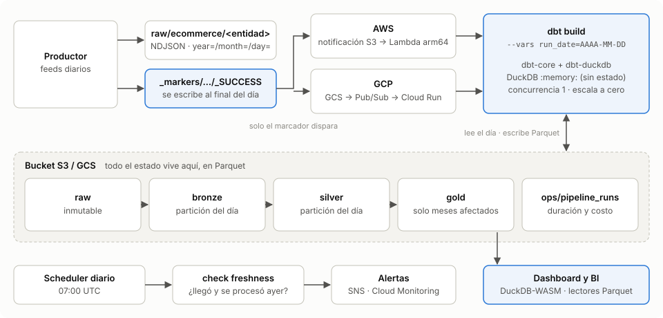

# Lakehouse serverless: DuckDB + dbt-core sobre S3/GCS

[](https://github.com/galvysRodriguez/serverless-lakehouse-duckdb-dbt/actions/workflows/ci.yml)
[](https://galvysrodriguez.github.io/serverless-lakehouse-duckdb-dbt/)


[](LICENSE)

**Español** · [English](README.en.md) ·
[**Demo en vivo**](https://galvysrodriguez.github.io/serverless-lakehouse-duckdb-dbt/) ·
[Linaje dbt](https://galvysrodriguez.github.io/serverless-lakehouse-duckdb-dbt/dbt/)

> **TL;DR.** Un data warehouse que no paga por estar encendido. Los datos viven como
> Parquet en S3/GCS, cada día de datos dispara una Lambda (o Cloud Run) que corre
> `dbt build` con DuckDB en memoria y se apaga. Cada ejecución lee solo la partición
> del día y Gold recalcula solo los meses afectados. Un test verifica que ese
> resultado incremental sea idéntico a reprocesar todo. Cada ejecución registra su
> duración y su costo estimado, y un chequeo diario alerta si un día no llegó.
> Mismo código en local, AWS y GCP, con Terraform para ambas nubes.



Data warehouse sin servidores siempre encendidos: los datos viven como Parquet en
almacenamiento de objetos, **DuckDB** los procesa en memoria y **dbt-core**
(`dbt-duckdb`) define las capas **Bronze → Silver → Gold**. El cómputo corre en
**AWS Lambda** o **GCP Cloud Run**, se dispara por eventos y escala a cero.

El mismo código corre en local, en AWS y en GCP. Solo cambian `LAKE_ROOT` (carpeta,
`s3://` o `gs://`) y `DBT_TARGET` (`local`, `aws`, `gcp`).

<details>
<summary>Flujo de rutas en el bucket</summary>

```
 productor ──► raw/ecommerce/<entidad>/year=/month=/day=/*.json
              raw/ecommerce/_markers/year=/month=/day=/_SUCCESS ──┐
                                                                 │ evento
            ┌────────────────────────────────────────────────────┘
            ▼
   AWS: notificación S3 ──► Lambda (imagen)          ┐
   GCP: notificación GCS ──► Pub/Sub push ──► Cloud Run ├─► dbt build --vars run_date=AAAA-MM-DD
                                                     ┘        │  DuckDB :memory:
                                                              ▼
   bronze/<entidad>/year=/month=/day=/part_0.parquet   (solo la partición del día)
   silver/<entidad>/year=/month=/day=/part_0.parquet   (solo la partición del día)
   gold/<tabla>/year=/month=/part_0.parquet            (solo los meses afectados)
   gold/<tabla>.parquet                                (dimensiones y totales)
```

</details>

## Demo

[galvysrodriguez.github.io/serverless-lakehouse-duckdb-dbt](https://galvysrodriguez.github.io/serverless-lakehouse-duckdb-dbt/) es un
sitio estático que `.github/workflows/pages.yml` regenera en cada push a `main`:

- **Dashboard**: descarga los Parquet de Gold y `ops/pipeline_runs` y los consulta en
  el navegador con DuckDB-WASM, sin backend. Muestra ventas y también lo que cuesta
  producirlas: duración de cada ejecución diaria y costo estimado con precios de Lambda.
- **Documentación de dbt** (`/dbt/`): modelos, columnas con sus contratos, tests y linaje.

Los datos son sintéticos: el workflow genera ~2 meses, corre el pipeline día por día
como lo harían los eventos y publica el resultado. En local: `make site-serve`.

## Inicio rápido (local)

Requiere Python ≥ 3.11.

```bash
make install         # crea .venv e instala el paquete + dbt-duckdb
make generate        # 7 días de datos e-commerce sintéticos en ./data/lake/raw
make run             # dbt build día por día (como lo haría cada evento)
make test            # pytest: unitarios + pipeline de punta a punta
```

Consultar el resultado con DuckDB:

```bash
.venv/bin/python -c "import duckdb; print(duckdb.sql(\"from 'data/lake/gold/customer_ltv.parquet'\"))"
```

Otros comandos:

```bash
.venv/bin/lakehouse run --date 2026-10-21                 # reprocesar un día (idempotente)
.venv/bin/lakehouse run --date 2026-10-21 --select tag:gold
make generate START=2026-09-01 END=2026-09-30             # rango propio
make test-unit                                            # sin el test e2e
.venv/bin/lakehouse report --days 30                      # duración y costo estimado por ejecución
.venv/bin/lakehouse check-freshness                       # ¿llegó y se procesó ayer?
make lint
make smoke                                                # imágenes Lambda/Cloud Run contra un lago local
make docs                                                 # linaje dbt en localhost:8080
make site-serve                                           # dashboard + dbt docs en localhost:8000
```

## Capas

| Capa   | Modelos | Qué hace | Escritura |
|--------|---------|----------|-----------|
| Raw    | (productor) | NDJSON tal como llega. `orders` trae altas **y** cambios de estado de días previos (CDC), con duplicados y ruido intencional. | inmutable |
| Bronze | `brz_orders`, `brz_customers`, `brz_products` | Lectura tipada del raw del día + `_source_file`, `_loaded_at`. | partición del día |
| Silver | `slv_orders`, `slv_order_items`, `slv_customers`, `slv_products` | Limpieza (estado/email normalizados), deduplicación dentro del día, desanidado de items. | partición del día |
| Gold   | `gld_daily_sales`, `gld_customer_monthly`, `gld_product_monthly` | Agregados por mes de creación del pedido, con la versión vigente de cada pedido. | solo meses afectados |
| Gold   | `gld_dim_customers`, `gld_dim_products` | Dimensiones SCD1: versión anterior + cambios del día. | archivo completo (pequeño) |
| Gold   | `gld_customer_ltv`, `gld_product_performance` | Totales históricos sumando los agregados mensuales. | archivo completo (pequeño) |

## Calidad: contratos, volumen y frescura

- **Contratos** (`contract: enforced`) en todos los modelos de Silver y Gold: nombres y
  tipos de columnas fijos, y `not_null` en las claves de Silver, que DuckDB aplica al
  escribir. Si el productor cambia la forma del raw, el build falla en Silver. Bronze
  guarda el dato tal cual llegó y Gold no se toca.
- **Volumen**: `assert_bronze_orders_not_empty` falla si un día trae marcador pero no
  trae pedidos.
- **Frescura**: si el productor no entrega, no hay evento ni error. Un job diario
  (EventBridge Scheduler / Cloud Scheduler, 07:00 UTC) llama al pipeline con
  `{"check": "freshness"}`. Falla si al día anterior le falta el marcador o una
  ejecución exitosa en `ops/pipeline_runs`, y eso dispara las alertas. En local:
  `lakehouse check-freshness --date 2026-10-21`.
- **Tests de dbt**: `accepted_values` y unicidad por partición en Silver (solo la
  partición procesada); `unique`/`not_null` en Gold; conciliación ingreso diario = suma
  de líneas en los meses recalculados.

## Particionamiento e idempotencia

- Rutas estilo Hive `year=/month=/day=` en raw, bronze y silver. Bronze y silver
  filtran por esas columnas y DuckDB lee **solo** la carpeta del día (partition
  pruning). Verificado con `EXPLAIN ANALYZE`: `Scanning Files: 1/3`.
- Cada partición se escribe como `part_{i}.parquet` con `OVERWRITE_OR_IGNORE`, así que
  reprocesar un día sobrescribe sus archivos y no duplica nada ni toca otros días.
- La base DuckDB es `:memory:`: todo el estado está en el bucket, por eso cualquier
  instancia efímera puede procesar cualquier día.
- Un solo objeto dispara el pipeline: el marcador `_SUCCESS` que el productor escribe
  **después** de subir todos los feeds del día.
- Backfill de todo el histórico: `lakehouse run --full-scan` (lee todo el lago).
- Al arrancar, un hook registra vistas sobre los Parquet que ya existen. Por eso
  `--select tag:gold` recalcula Gold a partir de silver sin releer raw ni bronze.

## Gold incremental por mes

Un día de datos solo puede cambiar los meses en que se crearon los pedidos que
llegaron ese día (altas y cambios de estado). `affected_months()` los calcula
leyendo la partición de silver del día, y Gold:

1. Lee silver solo desde el primer día del mes afectado más antiguo. DuckDB descarta
   el resto de archivos por las columnas de partición.
2. Reescribe solo las particiones `year=/month=` de esos meses en `gld_daily_sales`,
   `gld_customer_monthly` y `gld_product_monthly`.
3. Recalcula los totales (`gld_customer_ltv`, `gld_product_performance`) sumando
   esos agregados mensuales (una fila por cliente o producto y mes), no silver.
4. Actualiza las dimensiones fusionando su versión anterior con los cambios del día.

El costo diario depende del mes en curso, no del tamaño del histórico. El test
`test_incremental_gold_equals_full_rebuild` verifica que el resultado sea idéntico
al de reprocesar todo con `--full-scan`.

Supuesto: los cambios de un pedido llegan siempre después de su creación. Si un
productor reenvía datos de meses viejos, ese mes se recalcula igual, porque entra en
`affected_months`; solo se lee más silver.

## Costo por ejecución

Cada `dbt build` completo deja una fila en
`ops/pipeline_runs/year=/month=/day=/<run_id>.parquet` (append-only) con:

- duración y resultado, y tiempo de cada modelo y test;
- bytes de raw leídos, filas de bronze/silver y bytes Parquet escritos en el día;
- `est_cost_usd`: duración × precio por segundo de la configuración desplegada.

Terraform calcula ese precio desde la memoria/CPU configurada y precios de lista
(variables `lambda_price_per_gb_second` y `price_per_*`, que conviene verificar para tu
región) y lo pasa como `LAKEHOUSE_COST_PER_SECOND`. Es una estimación de cómputo:
no incluye almacenamiento, requests a S3/GCS, el arranque en frío ni la capa
gratuita. En local queda vacío.

```bash
LAKE_ROOT=s3://mi-bucket .venv/bin/lakehouse report --days 30
```

Muestra el resumen (ejecuciones, fallidas, duración, costo y proyección mensual),
el detalle por día de datos y los modelos más lentos. La tabla se puede consultar
directo con DuckDB o con cualquier herramienta que lea Parquet.

## Despliegue

Las dos nubes siguen el mismo patrón en dos fases, porque la función/servicio necesita
que la imagen exista antes de crearse:

### AWS (S3 + Lambda)

```bash
cp infra/aws/terraform.tfvars.example infra/aws/terraform.tfvars   # editar bucket_name, email
make aws-bootstrap          # crea el repositorio ECR
make aws-deploy TAG=v1      # build arm64 + push + terraform apply
```

Crea: bucket con cifrado, bloqueo público y ciclo de vida; ECR con retención de 5
imágenes; Lambda de imagen arm64 (3 GB, 15 min, concurrencia reservada 1) con permisos
de solo lectura sobre `raw/` y escritura en `bronze/ silver/ gold/`; notificación S3
filtrada a `raw/ecommerce/_markers/*_SUCCESS`; logs con retención de 14 días;
alertas por SNS; presupuesto mensual opcional.

Para disparar un día a mano: `aws lambda invoke --function-name lakehouse --payload '{"run_date":"2026-10-21"}' --cli-binary-format raw-in-base64-out out.json`.

> Construir arm64 en una máquina x86 requiere emulación (`docker buildx` con QEMU).
> Si prefieres x86, usa `AWS_PLATFORM=linux/amd64` y `lambda_architecture = "x86_64"`.

### GCP (GCS + Cloud Run)

```bash
cp infra/gcp/terraform.tfvars.example infra/gcp/terraform.tfvars   # project_id, bucket_name
make gcp-bootstrap          # habilita APIs y crea Artifact Registry
make gcp-deploy TAG=v1      # build amd64 + push + terraform apply
```

Crea: bucket con ciclo de vida Nearline/Coldline para raw; Artifact Registry con
limpieza; Cloud Run (`min=0`, `max=1`, concurrencia 1, CPU solo durante la petición);
notificación GCS filtrada por prefijo → Pub/Sub → push autenticado con OIDC; claves
HMAC en Secret Manager para que DuckDB acceda a GCS; dead-letter y alertas de
Monitoring; presupuesto opcional.

## Alertas

| | AWS | GCP |
|---|---|---|
| Fallo tras reintentos | Destino `on_failure` de la Lambda → SNS (incluye el evento y el error) | Dead-letter de Pub/Sub tras `max_delivery_attempts` (5) → alerta de Monitoring |
| Cualquier error | Alarma `Errors ≥ 1` | Alerta por respuestas 5xx de Cloud Run |
| Cerca del límite de tiempo | Alarma: duración > 80 % del timeout (15 min) | — |
| Día no entregado o no procesado | Chequeo diario de frescura → error → SNS | Chequeo diario de frescura → 5xx → alerta |

Configura `alert_email` en `terraform.tfvars`. En AWS hay que confirmar la
suscripción desde el correo que envía SNS. En GCP los mensajes fallidos quedan 7 días
en la suscripción `<name>-markers-dlq` para revisarlos o reinyectarlos.

Cada reintento vuelve a correr dbt. Para no gastar en reintentos inútiles ante un
error permanente, baja `max_delivery_attempts` (GCP) o `maximum_retry_attempts` (AWS).

## Palancas FinOps incluidas

- **Scale-to-zero**: sin tráfico no hay cómputo facturado (Lambda por invocación;
  Cloud Run con `min_instance_count = 0` y `cpu_idle = true`).
- **Partition pruning**: cada ejecución lee y escribe un solo día en bronze/silver.
- **Filtro de eventos en origen**: solo el marcador `_SUCCESS` despierta el cómputo.
  Las escrituras propias del pipeline no generan invocaciones.
- **Parquet columnar** en bronze/silver/gold, mucho más barato de escanear que JSON.
- **Ciclo de vida de almacenamiento**: raw y bronze bajan de clase con el tiempo. En
  S3 solo se mueven objetos >128 KB, porque IA/Glacier IR cobran ese mínimo por objeto
  y mover archivos chicos encarece.
- **Arm64 (Graviton)** en Lambda; retención acotada de logs e imágenes.
- **Presupuestos** con alerta al 80 % (pronóstico) y 100 % (real), filtrados por la
  etiqueta `project`. En AWS hay que activarla como *cost allocation tag*.

## Límites conocidos y decisiones

- **Un día a la vez**: concurrencia 1 en ambas nubes para que dos ejecuciones no
  escriban las mismas particiones de Gold a la vez. En cuentas AWS nuevas (límite de 10) no se puede reservar
  concurrencia: usa `reserved_concurrency = -1`.
- **Tiempo máximo**: 15 min en Lambda. En GCP el *ack deadline* de Pub/Sub es de 10 min:
  si un build tarda más, el mensaje se reentrega (es idempotente, pero gasta). Para
  cargas largas conviene Cloud Run Jobs.
- **Días sin datos**: un marcador sin pedidos hace fallar el build a propósito (test
  de volumen y contrato), porque `dbt-duckdb` escribiría una fila de NULLs en vez de un
  archivo vacío. Si tu negocio tiene días sin ventas legítimos, desactiva ese test o no
  escribas el marcador esos días.
- **Secretos**: el secreto HMAC de GCS queda en el estado de Terraform. Usa un backend
  remoto cifrado (ver `versions.tf`).

## CI

`.github/workflows/ci.yml` corre en cada push a `main` y en cada PR:

- `ruff` y `pytest` (incluido el pipeline de punta a punta).
- `terraform fmt -check` y `terraform validate` para AWS y GCP.
- Build de la imagen Lambda en arm64 (la de producción).
- Build de ambas imágenes en amd64 y `scripts/smoke_images.sh`: invoca la Lambda por
  su emulador y le envía a Cloud Run un mensaje Pub/Sub simulado.

`.github/workflows/pages.yml` publica la demo en GitHub Pages (requiere
*Settings → Pages → Source: GitHub Actions*).

## Estructura

```
src/lakehouse/        CLI, generador, runner de dbt, métricas y handlers (aws_lambda, gcp_cloud_run)
dbt/                  proyecto dbt (profiles.yml incluido, targets local/aws/gcp)
  macros/lake.sql     rutas del lago, filtro de partición, deduplicación
infra/aws, infra/gcp  Terraform por nube
tests/                pytest (eventos/particiones + e2e contra un lago temporal)
scripts/              prueba de humo de las imágenes y export de datos del sitio
site/index.html       dashboard estático (DuckDB-WASM)
docs/                 diagrama de arquitectura
Dockerfile            targets `aws` (Lambda) y `gcp` (Cloud Run)
```

## Licencia

[MIT](LICENSE)
